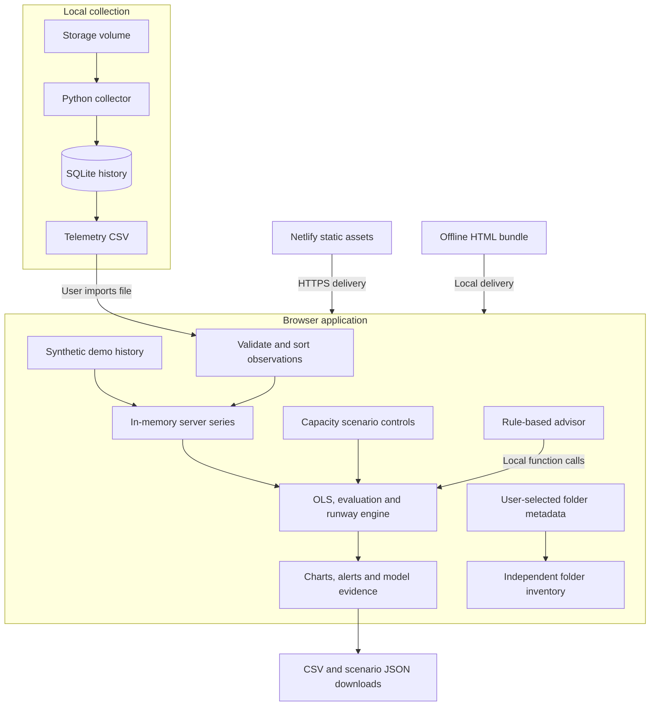

# STRATA / Intelligent Storage Capacity

A working storage observatory for the LLT Unit 5 case study, Section G1.

## Open the UI immediately

Live demo: https://cosmic-treacle-ecfb9c.netlify.app (no login required).

Presentation: https://cosmic-treacle-ecfb9c.netlify.app/presentation

For an offline backup, double-click **`dist/STRATA-Offline.html`**. This is the complete dashboard in one file, with CSS, charts, model and demo observations embedded. No installation, API key or server is needed. `dist/index.html` is the multi-file deployment entrypoint. The presentation is `dist/presentation.html`.

## What works

- Three selectable servers with 90 historical observations each, clearly labelled synthetic.
- Ordinary least squares fitted from observations, anchored future forecasts and approximate 95% prediction bands.
- Chronological 70/20 evaluation on the reset dataset: MAE, RMSE, training R² and a naive baseline.
- A forecast scrubber, selectable chart horizon and hover inspection.
- Measured and forecast threshold alerts with adjustable limits and session-only acknowledgement.
- Capacity addition, hypothetical reclaim and growth-multiplier scenarios.
- A deterministic advisor that executes `compare_servers`, `forecast_threshold`, `plan_capacity`, or `evaluate_model` and shows actual arguments/results.
- Synthetic next-day simulation with recalculation and reset.
- Validated telemetry CSV import/export and local folder metadata inspection.
- A Python collector that stores actual disk usage in SQLite and exports compatible CSV.

The advisor is not an LLM. Regression is a fitted statistical model. The starting dataset is synthetic; actual telemetry must be collected or imported separately.

## Technology

| Layer | Implementation | Reason |
| --- | --- | --- |
| Interface | HTML, CSS, JavaScript | Works directly from a file and static hosting |
| Charts | SVG | Interactive, dependency-free and readable offline |
| Forecast | OLS in a pure JavaScript module | Testable calculations and visible model evidence |
| Collection | Python standard library | Measures real containing-volume usage |
| History | SQLite | Local, durable timestamped observations |
| Exchange | CSV | Inspectable data and straightforward imports |
| Hosting | Netlify static hosting | No server or database credentials in the frontend |

## System architecture

STRATA uses **local collection + browser analysis + static hosting**. The deployed app performs its calculations in the browser; Python and SQLite run on the machine being measured. CSV is the explicit transfer boundary. There is no hosted telemetry API or cloud database in this version.



### Runtime flow

1. **Collect:** `collector.py` samples actual volume usage and commits timestamped readings to local SQLite.
2. **Transfer:** export elapsed-day CSV and select it in **Data & collection**. Import validates data before replacing browser state.
3. **Evaluate:** train OLS on the earlier 78% of observations and test on the remainder; 90 samples produce a 70/20 split.
4. **Forecast:** refit all history and anchor future demand at the latest observation. Compute threshold crossings and an illustrative uncertainty band.
5. **Decide:** show measured/current and forecast alerts, compare hypothetical expansion/reclaim scenarios, and inspect advisor function results.
6. **Export:** download telemetry or a scenario. Data remains in browser memory unless explicitly exported; the app does not upload it to a backend.

| Boundary | Runs where | Stored data |
| --- | --- | --- |
| Collector and history | Local machine | Durable SQLite readings |
| Dashboard and calculation engine | Browser | Session-only series, thresholds and scenarios |
| Static deployment | Netlify | Published HTML, CSS and JavaScript |
| Code and documentation | GitHub | Source, tests and report; no measured machine telemetry |

The capacity planner uses a fixed 90% runway target and recommends expansion for 80% utilization at day +90. Alert thresholds are independently adjustable. The advisor uses deterministic rules and local functions, not an LLM. Folder inspection is separate from historical volume forecasting. The hosted app does not automatically connect to remote machines.

**[Read the complete standalone architecture document →](docs/ARCHITECTURE.md)**

It includes the full system diagram, browser modules, runtime sequence, SQLite schema, CSV contracts, model equations, advisor routing, deployment diagram, security boundaries, failure handling, validation and future extensions.

## Real collection

```sh
python3 collector.py --path . --once
python3 collector.py --path . --interval 60
# Press Ctrl+C after collecting samples.
python3 collector.py --export telemetry.csv
```

Import the exported CSV through **Data & collection**. The schema is `server,day,used_gb,capacity_gb`. `day` is elapsed real time expressed in days, not an artificially incremented sample counter. Three distinct timestamps are required to fit a model, ten to show holdout metrics. A few minutes of samples are not adequate evidence for reliable long-term forecasting. If volume capacity changes, start a new series/database.

The collector does not inspect file contents. The separate legacy `scanner.py` is available for optional read-only duplicate inventory; its JSON is not the telemetry CSV used by the v2 dashboard.

## Demonstration in five minutes

1. Overview: select Atlas, Nova and Vault. Explain the synthetic-data label.
2. On Atlas, scrub forward. Point out observed usage, forecast, thresholds and interval.
3. Click **Simulate next day**, observe recalculation, then reset for reproducible numbers.
4. Planner: select Atlas and add 250 GB. Its 90% runway grows from 21 to 77 days.
5. Model lab: show 70 training and 20 test observations, with Atlas test MAE 5.37 GB.
6. Advisor: ask which server reaches 90% first and inspect `compare_servers` results.
7. Data: inspect a prepared local folder or import a measured telemetry file.

## Validation

```sh
node --test tests/engine.test.js
python3 -m unittest discover -s tests
node scripts/build.mjs
```

Nine JavaScript tests cover exact-fit recovery, holdout separation, threshold edges, non-growing trends, input validation, CSV roundtrip, expansion sufficiency and advisor dispatch. Three Python tests cover real volume reads/elapsed-time export and the optional scanner's duplicate/symlink behavior.

## Deployment

The `dist` directory is ready for static deployment. `netlify.toml` sets its publish path. To deploy from GitHub, import this repository into Netlify, leave the build command empty and set the publish directory to `dist`. For manual deployment, upload a ZIP containing the contents of `dist` with `index.html` at its root.

The public app is deployed on Netlify through a manual ZIP upload. GitHub pushes do not automatically redeploy it; upload a fresh dist bundle for future releases. The earlier owner-private ChatGPT Sites deployment remains available. See `docs/DELIVERY_STATUS.md` for verified checks.

## Model details and limitations

OLS minimizes squared residual error. Evaluation fits the first floor(0.78 × n) observations and tests the remaining observations (at least two). The naive baseline holds the last training value constant. The app then refits all observations for the displayed equation and operational slope. Forecast values are `latest_usage + fitted_slope × future_days`, anchored at the last observation. Runway is the ceiling of threshold headroom divided by positive slope.

The approximate 95% interval uses `1.96 × residual_standard_error × sqrt(1 + 1/n + (x - mean_x)^2 / Sxx)`. It uses the OLS residual variance while displaying an anchored forecast. It is an illustrative uncertainty band, not a calibrated guarantee. Autocorrelation, workload shifts and short sample spans can invalidate its assumptions. Demand forecasts can exceed physical capacity; observations cannot. Imported series require constant capacity and unique times.

Alerts and scenarios are browser-session state. Imported telemetry and folder metadata remain in browser memory. The app does not upload them, monitor background servers, auto-delete files, or provision disks. Production use would require longer telemetry histories, authenticated agents, audit logging, reliable data ingestion and workload-aware modelling.

## Accounts required

- GitHub: existing connected account, private source repository.
- Netlify: existing connected account hosts the public demo; viewers need no account.
- ChatGPT: only needed to view the earlier private Sites deployment.
- Python: installed locally for real collection, no account.
- No Supabase, AWS, OpenAI API, Figma or paid AI account is needed for this implementation.

## Team and faculty

| Member | Registration number |
| --- | --- |
| PANCHUMARTHI VENKATA SAHITH | RA2311003010368 |
| ASWANTH S P | RA2311003010399 |
| BAJANTRI CHIKULAGURI TULASI RAM | RA2311003010422 |

Section G1. Faculty: Dr. V.S.Bakkialakshmi, Assistant Professor, Faculty Code 103043.
