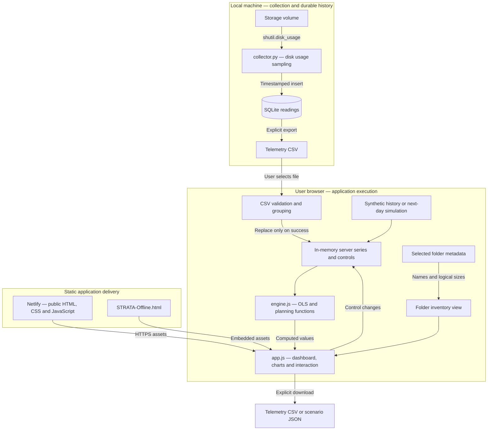
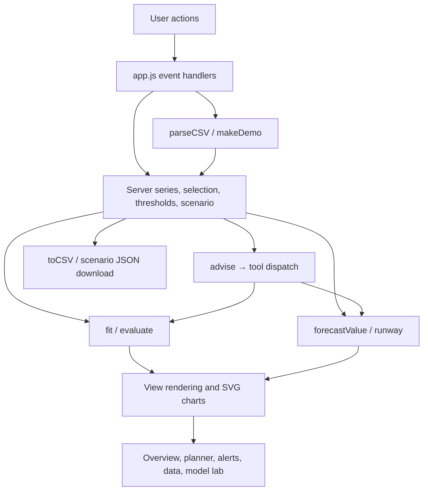
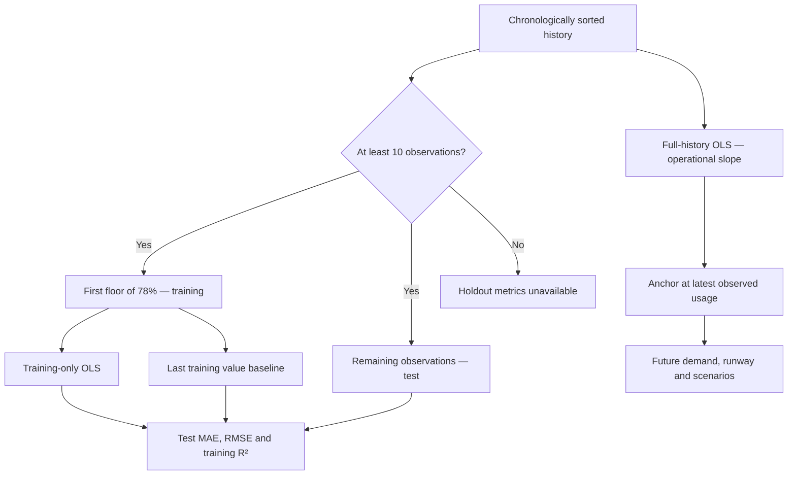
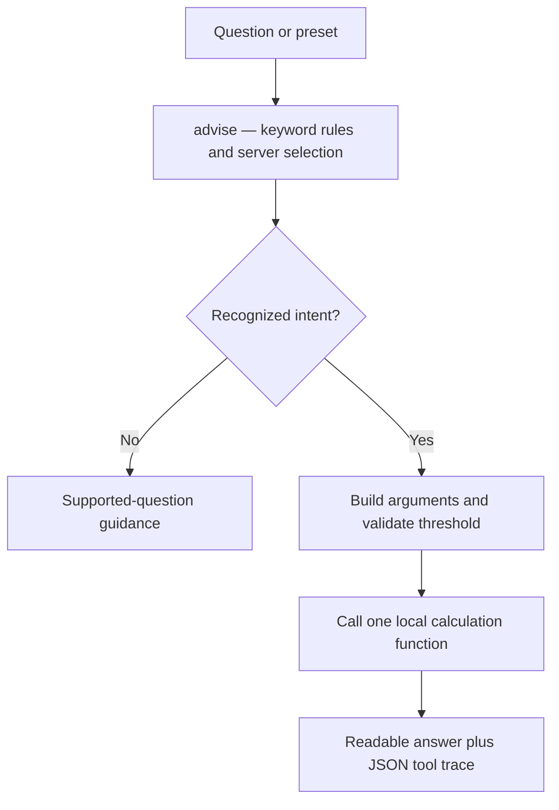
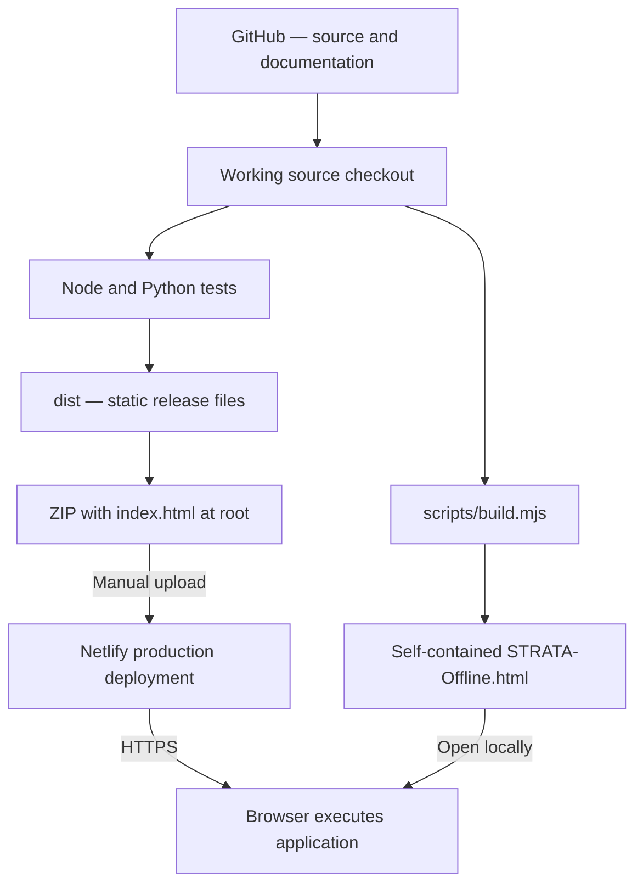

# STRATA — Complete System Architecture

**Project:** Intelligent Storage Capacity · LLT Unit 5 · Section G1  
**Architecture status:** implemented v2; documentation updated 17 November 2026.  
**Live app:** https://cosmic-treacle-ecfb9c.netlify.app  
**Related:** [README](../README.md) · [Verification record](DELIVERY_STATUS.md) · [Viva guide](VIVA.md)

## 1. Purpose and architectural style

STRATA supports a laboratory administrator deciding which storage volume needs attention, when it may cross a utilization threshold, and how capacity changes affect that estimate. It is a **local collection and browser analysis system**, delivered as a static web application. Python measures a local volume; SQLite retains readings; CSV transfers history into the browser. JavaScript fits the model and renders results. There is no hosted application server, ingestion API, cloud database or LLM dependency in this implementation.

The same UI runs from Netlify or the self-contained offline HTML file. Synthetic history enables a repeatable demonstration; imported measurements follow the same calculation path. An imported file is user-supplied evidence, not an independently authenticated telemetry source.

## 2. Complete system diagram



**Boundary:** Netlify delivers application assets; the application code does not send imported telemetry or folder metadata back to Netlify. A hosted page still makes ordinary hosting requests, and Netlify may inject its own badge code. No background link exists between the hosted dashboard and the local collector.

## 3. Components and responsibilities

| Component | Source | Responsibility | Persistence |
| --- | --- | --- | --- |
| Page structure | `dist/index.html` | Navigation, controls, dialogs and five views | Static file |
| Visual design | `dist/style.css` | Responsive layout, chart styling, typography and states | Static file |
| UI controller | `dist/app.js` | Events, selected server, alerts, SVG charts, imports and exports | Browser memory |
| Calculation engine | `dist/engine.js` | OLS, holdout evaluation, runway, scenario projections and advisor dispatch | Pure calculations; no database |
| Volume collector | `collector.py` | Read actual volume usage at configurable intervals | Local SQLite |
| Offline builder | `scripts/build.mjs` | Embed CSS and JavaScript in a standalone HTML file | `dist/STRATA-Offline.html` |
| Presentation | `dist/presentation.html` | Eight-section browser presentation | Static file |
| Legacy inventory | `scanner.py` | Optional read-only duplicate inventory | Separate output; not the telemetry pipeline |
| Tests | `tests/engine.test.js`, `tests/test_collector.py`, `tests/test_scanner.py` | Calculation, import and collection checks | Development evidence |
| Hosting configuration | `netlify.toml` | Publish directory `dist` and configured response headers | Repository configuration |

### Browser module diagram



The engine exposes `Capacity` in the browser and `module.exports` under Node so the same implementation is exercised by tests. The UI invokes functions directly; these calls are not HTTP endpoints or remote agent tools.

## 4. Collection, data contract and lifecycle

### Durable database

```sql
CREATE TABLE IF NOT EXISTS readings (
    server TEXT,
    timestamp REAL,
    used_gb REAL,
    capacity_gb REAL,
    PRIMARY KEY (server, timestamp)
);
```

| Field | Meaning |
| --- | --- |
| `server` | User-provided logical label, default `Local-Mac` |
| `timestamp` | Collection time as Unix seconds |
| `used_gb` | Used bytes divided by 1,000,000,000 |
| `capacity_gb` | Total bytes divided by 1,000,000,000 |

`shutil.disk_usage(path)` measures the volume containing the path; it does not recursively total that folder. A sample is committed immediately. Default interval is 60 seconds, minimum 1 second. `--once` collects one reading; `--export` exports existing readings and exits. The collector runs only while its process is running. It is not installed as an operating-system service.

### CSV transfer

```csv
server,day,used_gb,capacity_gb
Example-Lab,0,300,1000
Example-Lab,1,304,1000
Example-Lab,2,308,1000
```

This example is illustrative, not measured data. Export sets `day = (timestamp − first_timestamp_for_server) / 86400`. It preserves elapsed time rather than treating each sample as one day.

Import validation requires:

- File size at most 5,000,000 bytes in the UI.
- Required columns `server`, `day`, `used_gb`, `capacity_gb`; simple comma-separated fields, with no quoted-comma support.
- Nonempty server labels of at most 64 characters and finite numeric values.
- Nonnegative time and usage, positive capacity, and usage no greater than capacity.
- Unique times and constant capacity within each server series.
- At least 3 observations per server, at most 12 servers and 10,000 observations per server.

Records are sorted chronologically. The parser builds a candidate dataset first; only a successful parse replaces current state. A failed import shows a message and retains the previous dataset. Successful imports are labelled **Imported**, clear alert acknowledgements, and disable synthetic next-day simulation. Reset restores the synthetic series.

### In-memory objects

```javascript
{
  id: "import-0",
  name: "Example-Lab",
  role: "Imported telemetry",
  location: "LOCAL CSV",
  capacity: 1000,
  color: "#ffb454",
  source: "Imported",
  points: [{ day: 0, used: 300 }, { day: 1, used: 304 }, { day: 2, used: 308 }]
}
```

The browser keeps imported history, current view, server selection, thresholds and acknowledgements in memory. Scenario values are held in UI controls. Reloading does not restore these changes. SQLite is durable; browser-session state is not. Folder inventory is independent of time-series forecasting and reports logical file sizes, not disk capacity or reclaimable bytes.

## 5. End-to-end runtime sequence

```mermaid
sequenceDiagram
    actor Admin as Administrator
    participant Collector as Python collector
    participant DB as Local SQLite
    participant UI as Browser UI
    participant Engine as Calculation engine
    Admin->>Collector: Start sampling local volume
    loop While collector process runs
        Collector->>Collector: Read disk usage and actual time
        Collector->>DB: Insert and commit reading
    end
    Admin->>Collector: Stop sampling; request CSV export
    Collector->>DB: Read ordered observations
    DB-->>Collector: Timestamped history
    Collector-->>Admin: CSV with elapsed days
    Admin->>UI: Select telemetry CSV
    UI->>Engine: parseCSV(text)
    alt Invalid data
        Engine-->>UI: Validation error
        UI-->>Admin: Error; retain previous dataset
    else Valid data
        Engine-->>UI: Sorted server series
        UI->>Engine: Analyze history and calculate forecast
        Engine-->>UI: Utilization, model, errors and runway
        UI-->>Admin: Render charts, ledger and alerts
        Admin->>UI: Change capacity scenario
        UI->>Engine: Recalculate with scenario parameters
        Engine-->>UI: Before and after estimates
        UI-->>Admin: Updated comparison
    end
```

## 6. Forecasting and evaluation architecture

Two distinct model uses prevent evaluation from accidentally including future observations:



### Equations

Let observations be `(xᵢ, yᵢ)`, where `x` is elapsed day and `y` is used GB.

- OLS slope: `b = Σ((xᵢ − mean(x))(yᵢ − mean(y))) / Σ((xᵢ − mean(x))²)`.
- Intercept: `a = mean(y) − b × mean(x)`.
- Evaluation prediction: `a_train + b_train × test_day`.
- Operational forecast at `h` future days: `max(0, latest_used + b × h)`.
- Scenario forecast: `max(0, latest_used − reclaim + b × h × growth_factor)`.
- Scenario capacity: `existing_capacity + added_capacity`.
- Runway: `ceil((capacity × threshold / 100 − max(0, latest_used − reclaim)) / (b × growth_factor))` for positive growth and a threshold not yet reached.

Runway is zero when already at or above the threshold. A non-growing trend has no finite crossing estimate; code treats slopes at or below `1e-9` as non-growing. Forecast demand may exceed physical capacity, while imported observations must not. Planner runway uses a fixed 90% target; its minimum-expansion recommendation uses 80% utilization at day +90. These are separate from the adjustable warning/critical alert thresholds.

### Evaluation and uncertainty

For 90 demo observations, the chronological split is 70 training and 20 test observations. MAE averages absolute held-out errors; RMSE is the square root of mean squared errors. The naive baseline predicts the last training usage at every test time. Displayed evaluation R² comes from the training fit, not the held-out set.

The displayed approximate 95% band uses half-width:

`1.96 × residual_standard_error × sqrt(1 + 1/n + (day − mean_day)² / Sxx)`

It uses full-history OLS residual variance around an anchored displayed forecast. It is an illustrative normal approximation, not a calibrated prediction guarantee. Independent residuals, constant variance and continued linear growth are assumptions. Short collection spans, retention changes and sudden workloads can make extrapolation unreliable. Strong results on generated data do not prove accuracy on operational data.

## 7. Alerts, planning and advisor

### Alert rules

Defaults are warning 80% and critical 90%; UI controls preserve warning below critical. For each server, current utilization is compared with thresholds. An already reached threshold produces a **MEASURED** alert; otherwise a positive estimated crossing within 120 days produces a **FORECAST** alert. Here, “measured” identifies a current observation, even when that observation belongs to the labelled synthetic dataset. Critical current alerts suppress redundant warning current alerts. Acknowledgement toggles browser state; it sends no notification and does not change the data.

### Advisor function routing



| Function | Inputs used by advisor | Result |
| --- | --- | --- |
| `compare_servers` | Threshold, default 90% | Servers ranked by estimated crossing time |
| `forecast_threshold` | Selected or named server, threshold | Days to crossing and fitted GB/day growth |
| `plan_capacity` | Server; fixed horizon 90 days and target 80% | Projected demand and minimum extra capacity |
| `evaluate_model` | Server | Chronological holdout metrics, if available |

The advisor does not generate arbitrary code, call an external AI provider, change infrastructure or delete files. An unrecognized question receives guidance. Its visible trace contains the actual function name, arguments and returned object.

## 8. Deployment and offline architecture



**Current deployment:** manual ZIP upload; GitHub pushes do not automatically publish. `netlify.toml` declares `dist` as the publish directory for repository-based deployment, but there is no configured Git continuous deployment. Do not infer that configuration-file headers were applied to the manual ZIP deployment without inspecting actual responses. Netlify state files are excluded by `.netlify/` in `.gitignore`.

The earlier ChatGPT Sites deployment is a separate owner-private copy, not a backend, proxy or dependency of the Netlify site. No environment variables or application API keys are required. The project source repository is private; the Netlify UI is public. Only `dist` was uploaded, not the local SQLite history.

## 9. Security, operational scope and failure handling

| Boundary or condition | Implemented behavior |
| --- | --- |
| Filesystem access | Collector reads volume statistics; UI folder inspection reads file metadata selected by the user |
| Telemetry transfer | User manually exports/imports; application contains no telemetry-upload endpoint |
| Browser rendering | Dynamic server names and advisor JSON are HTML-escaped before interpolation |
| Invalid CSV | Error message; existing dataset retained |
| Insufficient history | Fewer than 3 points rejected on import; fewer than 10 gives no holdout metrics |
| Zero or declining usage trend | No finite future threshold crossing unless already reached |
| Capacity change in history | Reject; use a separate constant-capacity series |
| Network outage after download | Self-contained offline bundle remains available |
| Page reload | Initial synthetic dataset returns; imported browser state is not persisted |
| Disk collection failure | CLI error; no implemented retry queue or remote health monitor |
| Alerts and actions | Display-only alerts and hypothetical scenarios; no emails, disk provisioning or deletion |

The optional legacy duplicate scanner may read file content to identify duplicates; it is separate from the volume-statistics collector and browser metadata inventory. Do not apply the latter components' “no file-content reads” description to the scanner.

## 10. Validation and presentation evidence

The implementation has nine JavaScript tests and three Python tests. Browser checks on the Netlify deployment verified planner recalculation, simulation/reset, advisor execution, model display, presentation loading, and import of three actual disk readings. A seconds-long real sample confirms ingestion, not forecasting quality. See [Delivery status](DELIVERY_STATUS.md) for the exact scope and recorded console issue.

| Demo action | Architectural path demonstrated |
| --- | --- |
| Select server and move forecast inspector | In-memory series → engine → SVG rendering |
| Simulate a day | Synthetic generator → updated series → recalculation |
| Add 250 GB to Atlas | Scenario controls → runway function → 21-to-77-day comparison |
| Ask which server reaches 90% first | Question router → `compare_servers` → JSON trace |
| Import collector CSV | Actual volume → SQLite → CSV validation → model and ledger |
| Show Model lab | Chronological holdout → metrics distinct from full-history forecast |

## 11. Future extensions — not implemented

A production service could introduce authenticated collection agents, HTTPS ingestion, a shared time-series database, per-user access controls, scheduled forecasting, notifications and audit logs. These would replace manual transfer and memory-only state with a managed service. Workload-aware forecasting and evaluation against longer operational histories would be required before making stronger reliability claims. None of these components is shown as an existing dependency in the diagrams above.

## 12. Team

| Member | Registration number |
| --- | --- |
| PANCHUMARTHI VENKATA SAHITH | RA2311003010368 |
| ASWANTH S P | RA2311003010399 |
| BAJANTRI CHIKULAGURI TULASI RAM | RA2311003010422 |

Section G1 · Faculty: Dr. V.S.Bakkialakshmi, Assistant Professor · Faculty Code 103043.
